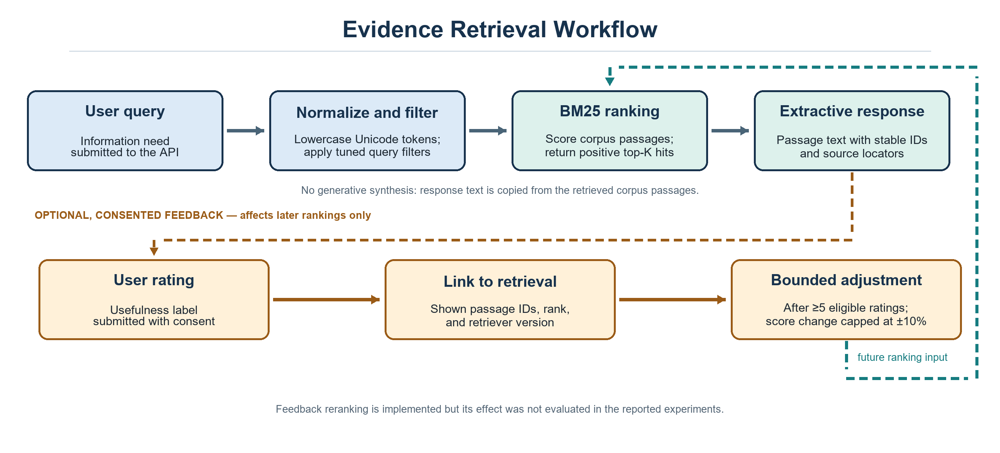

# Panchakarma Evidence Retrieval & Traceability Pipeline (VedAI)

[](https://www.python.org/downloads/)
[](https://fastapi.tiangolo.com/)
[](panchakarma_evidence/retrieval.py)
[](panchakarma_evidence/retrieval.py)

VedAI is a standalone, education-only API for searching a curated Panchakarma passage collection, returning source-locatable evidence, and recording consented feedback. It uses deterministic BM25 retrieval and extractive responses; it does not generate treatment recommendations or replace qualified clinical judgment.

The service runs independently of the separate VedAI frontend and recommendation backend. This repository contains the evidence API, corpus, evaluation scripts, and tests.

## What the service does

- Ranks corpus passages with BM25 (`k1=1.5`, `b=0.75`) and a versioned query stoplist/common-term filter.
- Returns copied passage text with stable chunk IDs, source metadata, page/section locators, and verification metadata.
- Checks whether a citation ID resolves to the loaded corpus and whether supplied text exactly matches the stored passage. This structural check does not prove semantic support or clinical correctness.
- Records retrieval-usefulness feedback only with explicit consent. Eligible ratings can make a bounded adjustment to later rankings; post-therapy reports and direct ratings do not affect retrieval ranking.
- Uses MongoDB if configured and reachable at startup; otherwise starts with local SQLite. A later MongoDB failure does not trigger runtime failover to SQLite.

### Request and evidence flow



The optional feedback loop requires at least five eligible ratings for a passage and retriever version, and its score adjustment is capped at ±10%. Its effect on retrieval quality has not been evaluated.

## Repository contents

| Path | Purpose |
|---|---|
| `panchakarma_evidence/` | FastAPI application, BM25 retrieval, and feedback storage |
| `research_dataset/` | Corpus records, query sets, source registry, schemas, and provenance notes |
| `scripts/evidence_rag/` | Source validation, retrieval evaluation, and traceability audit scripts |
| `results/` | Saved per-query rankings and metric summaries |
| `tests/` | API, corpus, retrieval, feedback, storage, and evaluation tests |

## Corpus and evaluation data

The complete corpus has 36 passages from four source IDs. Eight records are labeled as source summaries. The 18-passage corpus is retained for the development baseline comparison. Corpus records are not domain-expert reviewed as a collection; see [`research_dataset/README.md`](research_dataset/README.md) for source and extraction details.

| Dataset | Size | Use and qualification |
|---|---:|---|
| `corpus_chunks_complete.jsonl` | 36 passages | Current complete corpus snapshot |
| `corpus_chunks.jsonl` | 18 passages | Preserved baseline corpus for development-profile comparison |
| `evaluation_queries_ncism_dev.csv` | 12 queries | NCISM development mappings; not independently reviewed |
| `evaluation_queries_safety_dev.csv` | 6 queries | Safety development mappings; user-assumed and not independently reviewed |
| `evaluation_queries_synthetic_pilot.csv` | 20 queries | Synthetic development/debugging set; not a validated user-query benchmark |
| `evaluation_queries_heldout_test.csv` | 10 queries | Source-grounded descriptive set; its independent-curation metadata has not been externally audited |
| `synthetic_demo_corpus.jsonl` | 8 passages | Isolated synthetic fixture for `/api/evidence/demo-search`; not source evidence |

Each query currently has one mapped passage. Metrics therefore measure agreement with these mappings, not complete evidence coverage. The source PDFs are kept in `research_dataset/source_documents/` and are not copied into the Docker image. Source redistribution rights have not been fully reviewed.

## Quick start

### Requirements

- Python 3.11 or later
- Optional: MongoDB, if feedback/session persistence should use MongoDB instead of SQLite

### Windows PowerShell

From the repository root:

```powershell
py -3 -m venv .venv
.venv\Scripts\Activate.ps1
python -m pip install --upgrade pip
pip install -r requirements.txt
Copy-Item .env.example .env
python -m uvicorn panchakarma_evidence.api:app --host 127.0.0.1 --port 4100
```

The local command binds to `127.0.0.1:4100`. Change `--port` in the command if needed. The default corpus is the 36-passage complete corpus; set `CORPUS_PATH` to `research_dataset/corpus_chunks.jsonl` to load the 18-passage baseline corpus. When starting with `python -m panchakarma_evidence` instead, `PORT` controls the port and the server binds to `0.0.0.0`.

- Swagger UI: <http://127.0.0.1:4100/docs>
- ReDoc: <http://127.0.0.1:4100/redoc>
- Health: <http://127.0.0.1:4100/health>

If PowerShell blocks virtual-environment activation, use `\.venv\Scripts\python.exe` in place of `python` for the install and run commands.

## API overview

Interactive request/response schemas are available at `/docs` after the server starts.

| Method and path | Purpose |
|---|---|
| `GET /` | Service name, status, corpus size, and educational-use notice |
| `GET /health` | API and feedback-storage health |
| `POST /api/evidence/search` | Return ranked passages; accepts `query`, `limit` (or `top_k`), and optional `feedback_consent` |
| `POST /api/evidence/answer` | Package ranked passages as an extractive evidence response |
| `POST /api/evidence/feedback` | Record consented usefulness or separately classified post-therapy feedback |
| `GET /api/evidence/feedback/stats` | Summarize eligible retrieval-usefulness ratings |
| `GET /api/evidence/passages` | Browse passages; optional `procedure`, `source_id`, `limit`, and `offset` filters |
| `GET /api/evidence/passages/{chunk_id}` | Retrieve a passage by its stable chunk ID |
| `GET /api/evidence/sources` | List source-registry records |
| `GET /api/evidence/stats` | Summarize corpus and storage status |
| `POST /api/evidence/verify` | Resolve a citation ID and optionally compare supplied text with the stored passage |
| `POST /api/evidence/demo-search` | Search the synthetic plumbing-test fixture; results are explicitly not evidence |

### Search example

```powershell
curl.exe -X POST http://127.0.0.1:4100/api/evidence/search `
  -H "Content-Type: application/json" `
  -d '{"query":"Indications and contraindications of Vamana","top_k":3}'
```

### Consent and submit usefulness feedback

To associate a rating with passages actually shown to a user, request an opted-in retrieval session. The search response contains a `retrieval_id`; use that ID, the returned passage's `chunk_id`, and its 1-based rank in the feedback request.

```json
{
  "query": "Vamana procedure stages",
  "top_k": 3,
  "feedback_consent": true
}
```

Then submit a rating using the returned `retrieval_id` and passage details:

```json
{
  "retrieval_id": "<retrieval_id from the search response>",
  "evidence_id": "<chunk_id from a returned passage>",
  "rank": 1,
  "helpful": true,
  "reason_code": "useful",
  "feedback_type": "evidence_retrieval",
  "consent_status": "consented"
}
```

Direct passage ratings can be stored, but are excluded from retrieval-reranking statistics. Post-therapy feedback is also stored separately and never affects ranking. Feedback comments receive best-effort redaction for common email, phone, identifier, and date patterns; do not submit patient-identifying or other sensitive clinical details.

Procedure filters currently include `vamana`, `virechana`, `basti`, `nasya`, `raktamokshana`, `snehana`, `swedana`, `emergency`, and `governance`.

## Reproduce the saved evaluations

Validate the baseline and complete corpus metadata/source hashes:

```powershell
python scripts/evidence_rag/validate_sources.py
python scripts/evidence_rag/validate_sources.py --corpus research_dataset/corpus_chunks_complete.jsonl
```

Re-run the BM25 baseline/tuned comparison on the development query sets:

```powershell
python scripts/evidence_rag/evaluate.py --profile baseline --queries research_dataset/evaluation_queries_ncism_dev.csv --corpus research_dataset/corpus_chunks.jsonl --out results/evidence-rag-ncism-baseline
python scripts/evidence_rag/evaluate.py --profile tuned --queries research_dataset/evaluation_queries_ncism_dev.csv --corpus research_dataset/corpus_chunks.jsonl --out results/evidence-rag-ncism-dev
python scripts/evidence_rag/evaluate.py --profile baseline --queries research_dataset/evaluation_queries_safety_dev.csv --corpus research_dataset/corpus_chunks.jsonl --out results/evidence-rag-safety-baseline
python scripts/evidence_rag/evaluate.py --profile tuned --queries research_dataset/evaluation_queries_safety_dev.csv --corpus research_dataset/corpus_chunks.jsonl --out results/evidence-rag-safety-dev
```

The saved tuned-profile metrics are:

| Set and profile | Mean returned | Precision@5 | Precision among returned | Recall@5 | nDCG@5 |
|---|---:|---:|---:|---:|---:|
| NCISM development, baseline | 5.00 | 0.200 | 0.200 | 1.000 | 0.938 |
| NCISM development, tuned | 2.17 | 0.200 | 0.644 | 1.000 | 0.969 |
| Safety development, baseline | 5.00 | 0.200 | 0.200 | 1.000 | 0.938 |
| Safety development, tuned | 3.50 | 0.200 | 0.406 | 1.000 | 0.938 |
| Synthetic pilot, tuned | 4.40 | 0.200 | 0.277 | 1.000 | 0.888 |
| Held-out descriptive set, tuned | 4.00 | 0.200 | 0.287 | 1.000 | 0.926 |

These are descriptive scores on small labeled sets. The development labels are not independently reviewed; the synthetic pilot is for pipeline development; and the held-out set's independent-curation metadata has not been audited. Recall@5 of 1.000 means the one mapped passage per query was retrieved. It does not establish complete evidence coverage, clinical correctness, safety, or utility.

### Structural traceability audit

Run the structural audit for the three saved sets:

```powershell
python scripts/evidence_rag/evaluate_traceability.py --queries research_dataset/evaluation_queries_ncism_dev.csv --out results/traceability-ncism-dev
python scripts/evidence_rag/evaluate_traceability.py --queries research_dataset/evaluation_queries_safety_dev.csv --out results/traceability-safety-dev
python scripts/evidence_rag/evaluate_traceability.py --queries research_dataset/evaluation_queries_heldout_test.csv --corpus research_dataset/corpus_chunks_complete.jsonl --out results/traceability-heldout-test
```

The saved audits cover 87 answer items in total (26 NCISM, 21 safety, and 40 held-out descriptive). Citation-ID resolution, presence in the returned set, exact corpus-text equality, and locator completeness are each 1.000; query abstention is 0.000. These are structural checks of extractive outputs. They do not assess semantic support, source accuracy, or clinical safety.

## Tests

Install the dependencies above and run:

```powershell
pytest -v
```

The last recorded local run reported **31 passed, 1 warning**. Re-run the command to check the current working tree; the README does not enumerate a partial list of tests as if it were the full output.

## Configuration and deployment

Configuration is read from `.env` at the repository root:

| Variable | Default | Purpose |
|---|---|---|
| `PORT` | `4100` | Local API port |
| `CORPUS_PATH` | Complete 36-passage corpus | Relative or absolute path to the active corpus |
| `MONGODB_URI` | Empty | Optional MongoDB connection; SQLite is selected if MongoDB is omitted or unavailable at startup |
| `API_KEY` | Empty | Optional shared API key. When set, send `X-API-Key` or a Bearer token to protected API routes. Root, health, and API docs remain public. |
| `CORS_ORIGINS` | Empty (allow all origins) | Comma-separated browser origins, for example `http://localhost:5173` |
| `FEEDBACK_RETENTION_DAYS` | `365` | Retention window for feedback and retrieval sessions; must be at least one day |

For local Docker Compose deployment, Docker Desktop must be running:

```powershell
docker compose up --build
```

Compose starts the API and MongoDB with persistent named volumes. The API is exposed on the configured `PORT` (default `4100`). To stop the services, run `docker compose down`; named data volumes are retained. The Docker image excludes the source PDFs.

## Scope, privacy, and source-use notes

- Educational source retrieval only; not diagnosis, treatment advice, or a clinical recommendation.
- No generative language model writes the answer. The answer endpoint packages retrieved passage text and metadata.
- Citation verification checks IDs and exact text against the loaded corpus. A matching ID/hash does not prove that the source passage semantically supports a claim or is clinically current.
- API-key protection is optional and must be configured before exposing the service beyond a trusted local environment. Configure CORS to the intended origins for browser use.
- Comment redaction is best effort and is not a detector for all personally identifiable or protected health information. Do not submit patient identifiers or identifiable clinical details.
- Source redistribution and reuse rights have not been fully reviewed. Confirm permissions before redistributing corpus text or publishing a deployment.
